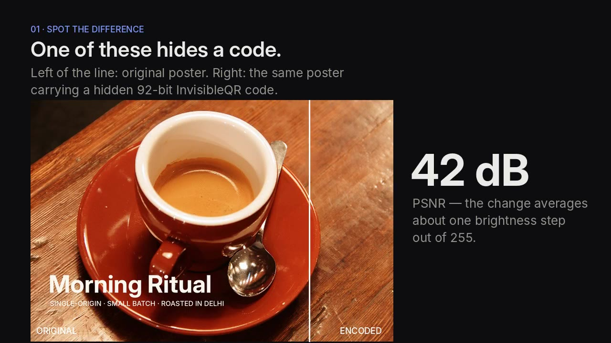
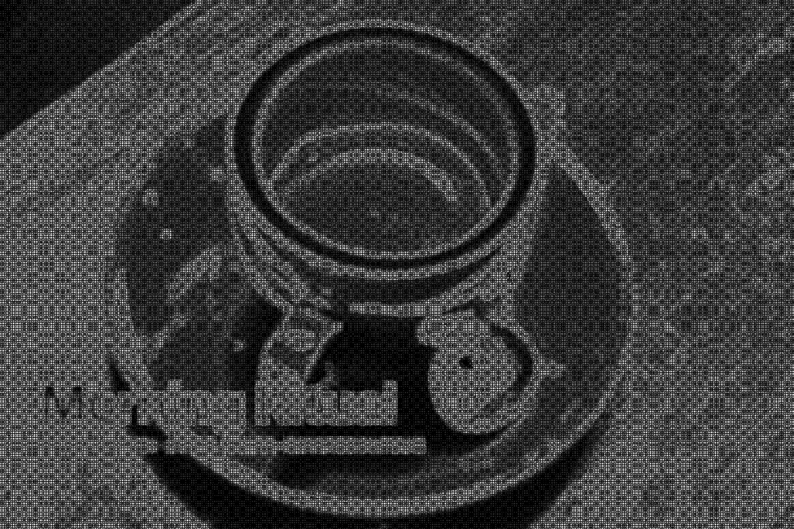

# InvisibleQR

🌐 **Live site:** https://saikiran9185.github.io/invisible-qr/

**A QR code you can't see.** InvisibleQR hides a small, recoverable code inside an ordinary image — a photo, poster, package or artwork — by repeating tiny encoded patterns across the whole picture. People see the normal image; a scanner reads the code.

The goal is *perceptually invisible, machine-detectable* encoding. A camera can only read what changes the pixels measurably, so the signal is kept below what the eye notices but above what a decoder can recover.

## Demo

**▶ [Watch the 50-second explainer](demo/explainer.mp4)**

[](demo/explainer.mp4)

A coffee poster is encoded with a hidden product ID, put through a simulated print + crooked scan, and decoded back:

| Poster with hidden code | Hidden pattern (×40) | Simulated scan |
|---|---|---|
|  |  |  |

Decoded from the scan ([`demo/5_decode_result.json`](demo/5_decode_result.json)):

```json
{ "protocol": "IQR-1", "id": "8F32A91C72B4D610", "type": "product", "verification": "valid", "profile": "print" }
```

Rebuild it yourself: `pip install scikit-image && python demo/make_demo.py && python demo/make_video.py`

## Two profiles

| | **Digital (C1)** | **Print (C2)** |
|---|---|---|
| Use for | files, screens, social media | posters, packaging, prints |
| How | QIM on DCT coefficients, 8×8 blocks | masked additive carrier + pilot pattern, convolutional code |
| Invisibility | ~43 dB PSNR | ~42 dB PSNR (adjustable) |
| Survives | JPEG ≥ 65, cropping | printing, scanning, **phone photos of the print** (angle, perspective, wall around it, uneven light, WhatsApp-size JPEG), any rotation |
| Doesn't survive | resize, rotation, print | posters that are tiny in the photo (< ~10 px per cell), blurry/shaky photos |

Both carry the same 92-bit **IQR-1** payload — a compact ID, not the content. The ID points to a record in a registry.

```json
{ "protocol": "IQR-1", "id": "8F32A91C72B4D610", "type": "product", "verification": "valid" }
```

## Reading it from a phone photo of the print

Point a phone at the printed poster, take a normal photo (the wall around it is fine), and decode the photo:

```bash
python -m iqr decode photo.jpg
```

What happens inside:

1. **Find the poster** — large four-sided outlines (paper edge or artwork edge), so walls, tape and frames around it don't matter.
2. **Fix the corners with the hidden pattern** — paper edges in photos are never exact (tape, shadows, curl). The faint pilot lattice is perfectly regular across the whole print, so the decoder nudges the 4 corners until the pilot's frequency peaks are sharpest. That removes the perspective almost exactly.
3. **Flatten** the poster and lock onto it with a full affine fit from both pilot peaks (scale, rotation, stretch and shear — a flattened photo is never exactly the right aspect ratio).
4. **Weighted voting** — busy parts of the artwork drown the signal, plain parts don't, so each cell's vote is weighted by how noisy its neighbourhood is. This alone took raw bit accuracy from 87 % to 96 % on a WhatsApp-size photo.
5. Error correction + CRC as before.

## The pattern scales with the print

The code is sized relative to the artwork, not in pixels: by default the shorter side holds **48 cells** (3 pattern repeats), whatever the file's resolution. An A5 flyer and an A0 banner carry the same pattern, just bigger — so a photo that frames the whole poster always sees enough of it, and bigger posters can be read from proportionally farther away.

Tell the encoder the print size and it reports (example: a 2480×3508 px file printed at A3) how big the pattern is on paper and how far a phone can read it:

```bash
python -m iqr encode poster.png poster_iqr.png --profile print --print-size A3
```
```json
"print": { "size_mm": [297, 420], "file_dpi": 212, "cell_mm": 6.23, "pattern_repeat_mm": 99.6,
           "photo_min_poster_width_px": 477, "phone_max_distance_m": 1.81,
           "phone_max_distance_m_if_sent_on_whatsapp": 0.72, "scanner_min_dpi": 29 }
```

Rule of thumb: the poster must be at least **~10 px per cell** in the photo — about 480 px wide with the default 48 cells. `--cells 32` makes a coarser pattern readable from ~1.5× farther (more visible up close); `--cells 64` is finer and needs closer photos.

## Does it need its own scanner?

It needs its own **decoder software**, not special hardware. Any flatbed scanner, phone camera or webcam captures the picture; `python -m iqr decode` (later, a phone app) reads the hidden code from it. A normal camera app won't show anything on its own — the same way a normal camera doesn't read Digimarc codes unless the app supports them.

## How the print profile survives a scanner

1. **Pilot pattern** — a faint, regular diagonal texture adds four sharp peaks to the image's frequency spectrum. After print + scan, where those peaks land tells the decoder the new **scale and rotation**.
2. **Resample** the scan back to the original grid.
3. **Lock on** — search cell offset, 90° orientation and tile phase using a 32-bit sync pattern.
4. **Vote** — the 16×16-cell tile repeats across the whole image; every copy is summed.
5. **Correct errors** — a rate-½ convolutional code with soft Viterbi decoding fixes ~20 of 196 bits; bits are scattered so flat regions don't wipe out neighbours.
6. **Verify** — CRC-16 rejects anything that isn't a real code.

Strength follows the image: more signal in textured areas (hair, fabric, foliage), less in flat areas (sky, plain packaging) where it would show.

## Results

Simulated print → scan (halftone, ink spread, crooked placement, scanner resolution, blur, exposure/gamma, noise, JPEG) on real photos at print-file size (~1500 px):

| Strength | PSNR | Decoded |
|---|---|---|
| 1.0 (default) | 42.4 dB | **12 / 12** |
| 0.7 | 45.4 dB | 11 / 12 |

Small files (~500 px) have fewer pattern copies: 9 / 12 at default strength. Unmarked images: **0 false codes in 27 tries**.

Digital profile: JPEG 95/85/75/65 ✅, ≤55 ❌, crops to 120×120 px ✅.

> These are simulations. The next step is real print-and-scan tests on your own printer and scanner — see the roadmap.

## Quick start

```bash
pip install -r requirements.txt

# digital
python -m iqr encode photo.png out.png --id 8F32A91C72B4D610 --type image

# print (use for anything that will be printed)
python -m iqr encode poster.png poster_iqr.png --profile print --type product

# simulate printing + scanning, then decode
python -m iqr simulate poster_iqr.png scan.jpg --scale 1.15 --angle 4
python -m iqr decode scan.jpg          # tries digital, print, then phone-photo mode

# simulate a phone photo of the print on a wall (angle, light, JPEG), then decode
python -m iqr simulate poster_iqr.png photo.jpg --photo --fill 0.5 --yaw 20
python -m iqr decode photo.jpg

# tests (~2 min)
pip install pytest && python -m pytest -q
```

Options: `--strength` (print: 0.6–1.4; lower = more invisible), `--cells` (print: cells across the shorter side, default 48), `--print-size` (A0–A6, LETTER or e.g. `420x594mm`), `--cell` (fixed cell size in px).

Phone-photo mode needs OpenCV: `pip install opencv-python-headless` (in `requirements.txt`).

### Real print tips
- Encode the **full-resolution** print file, not a preview — more copies of the pattern means more reliable decoding.
- Export as PNG/TIFF; print at 200–300 dpi or more.
- Scan at **300 dpi or higher**, straight, colour or greyscale.
- Phone: get the whole poster in the photo, fill at least half the frame if you'll send it over WhatsApp, hold still. Angles up to ~35° are fine.

## Roadmap

- **Phase 1 — Digital encoding** ✅ payload format, C1 codec, CLI, tests
- **Phase 1b — Print & scan** ✅ C2 codec, pilot-based geometry recovery, convolutional code, print-scan simulator
- **Phase 2a — Phone photos of prints** ✅ poster detection, pilot-based corner refinement, affine lock, weighted voting, print-size-aware pattern, phone-photo simulator
- **Phase 2b — Live camera** Android scanner (CameraX), decoding from video frames; neural encoder/decoder (StegaStamp-style) for even smaller/farther codes
- **Phase 3 — Physical print testing** real printers and paper, posters, packaging
- **Phase 4 — Universal protocol** open spec, reference decoder, registry (FastAPI + PostgreSQL), signed records, C2PA link

See [`docs/SPEC.md`](docs/SPEC.md) for the protocol draft.

## Prior work

- Tancik, Mildenhall, Ng — *StegaStamp: Invisible Hyperlinks in Physical Photographs*, CVPR 2020.
- Digimarc — commercial invisible codes printed on retail packaging.
- C2PA — signed content provenance; InvisibleQR can point to a C2PA manifest.

## Structure

```
iqr/payload.py      IQR-1 payload + CRC
iqr/codec.py        digital profile (C1)
iqr/print_codec.py  print profile (C2)
iqr/ecc.py          convolutional code + Viterbi
iqr/simulate.py     print-and-scan simulator
iqr/camera.py       phone-photo simulator (print on a wall, perspective, light, JPEG)
iqr/locate.py       find the poster in a photo, refine corners with the pilot, flatten
iqr/photo.py        phone-photo decoder
iqr/sizing.py       print size -> pattern size, reading distance
tests/              robustness tests
docs/               GitHub Pages site + SPEC.md
```

---
Saikiran Chepuri · B.Des Interaction Design, USDI
